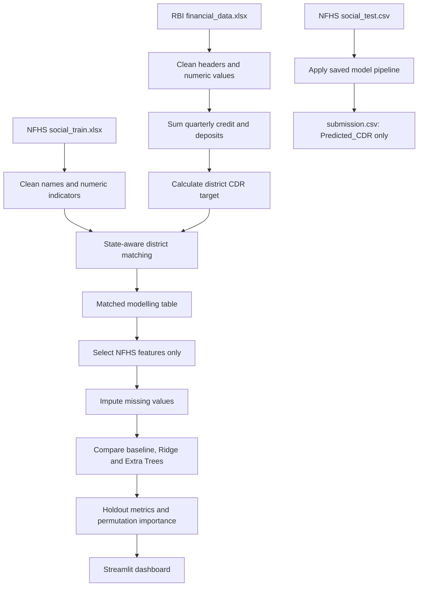

# CDR Sentinel — Financial Resilience Stress Test

CDR Sentinel explores whether district-level NFHS social and health indicators can help predict a district's Credit-Deposit Ratio (CDR). It combines data preparation, district matching, regression modelling, evaluation and a small Streamlit dashboard.

The project follows the supplied datathon brief. The target is calculated from RBI credit and deposits; **credit and deposits are not model inputs**. Only numeric NFHS columns are used as features.

## What the project does

1. **Load RBI data.** Read the workbook's multi-row header and convert quarterly credit/deposit values to numbers.
2. **Consolidate financial values.** Sum available quarterly credit and deposits for each district and calculate `CDR = 100 × total credit / total deposits`.
3. **Load NFHS data.** Preserve district/state labels and convert candidate indicators to numeric values.
4. **Match districts.** Prefer exact matches and then use state-aware fuzzy matching. A matching audit is saved for review.
5. **Prepare the model table.** Keep only NFHS numeric features, impute missing values inside a scikit-learn pipeline and exclude RBI-derived values from the predictors.
6. **Compare models.** Evaluate a median baseline, Ridge regression and Extra Trees on the same 80/20 holdout split.
7. **Explain and explore.** Calculate permutation importance and show the results in a Streamlit dashboard.
8. **Create the submission.** Generate a one-column `submission.csv` in the same row order as `social_test.csv`.

## Architecture



## Folder structure

```text
CDR Prediction/
├── data files
│   ├── financial_data.xlsx
│   ├── social_train.xlsx
│   └── social_test.csv
├── src/
│   └── pipeline.py
├── artifacts/                 # generated on first run
│   ├── model.joblib
│   ├── metadata.json
│   └── district_match_audit.csv
├── streamlit_app.py
├── run.py
├── requirements.txt
├── ARCHITECTURE.md
└── Problem Statement (1).pdf
```

## Run locally (Windows)

Open a terminal in this folder.

```powershell
py -m venv .venv
.\.venv\Scripts\Activate.ps1
python -m pip install --upgrade pip
pip install -r requirements.txt
python run.py
streamlit run streamlit_app.py
```

`run.py` trains/evaluates the pipeline if needed and writes `submission.csv`. The dashboard can be run separately; on its first run it trains the model and writes the artifacts.

## Current local validation

The included dataset produced the following results during one local run:

| Model | MAE | RMSE | R² |
|---|---:|---:|---:|
| Median baseline | 32.281 | 44.595 | -0.076 |
| Ridge regression | 25.632 | 31.540 | 0.462 |
| Extra Trees | 17.975 | 22.455 | 0.727 |

These numbers are a reproducible 80/20 random holdout estimate from the current code and data, not an official competition score. Re-running with different library versions or data edits may change results. If districts are spatially or statistically related, random holdout metrics can be optimistic; a grouped or spatial validation would be a useful next experiment.

## Important interpretation notes

- A fuzzy match is a proposed entity match, not ground truth. Review `artifacts/district_match_audit.csv`, especially fuzzy and unmatched rows.
- NFHS indicators are not necessarily measured at the same time as RBI aggregates. Treat the model as exploratory rather than a causal or future-forecasting model.
- Permutation importance shows predictive association, not causation.
- A positive `predicted CDR - actual CDR` residual identifies a district to investigate; it does **not** prove the district is underserved.
- This project is for analysis and learning, not for lending, investment or policy decisions.

## Resume-ready description

**CDR Sentinel — Financial Resilience Stress Test | Python, Pandas, Scikit-learn, Extra Trees, Streamlit**

- Built an end-to-end ML pipeline combining RBI district-level banking data with 100+ NFHS indicators, including multi-quarter financial aggregation, state-aware fuzzy district matching and data-quality auditing.
- Compared baseline, Ridge and Extra Trees regression models using a held-out validation set; achieved an RMSE of 22.455 and R² of 0.727 in the current local run, and developed a Streamlit dashboard for model evaluation, feature importance and district-level residual analysis.

Use these metrics on your resume only after reproducing them on your own machine. Explain the validation setup and limitations clearly in interviews.
